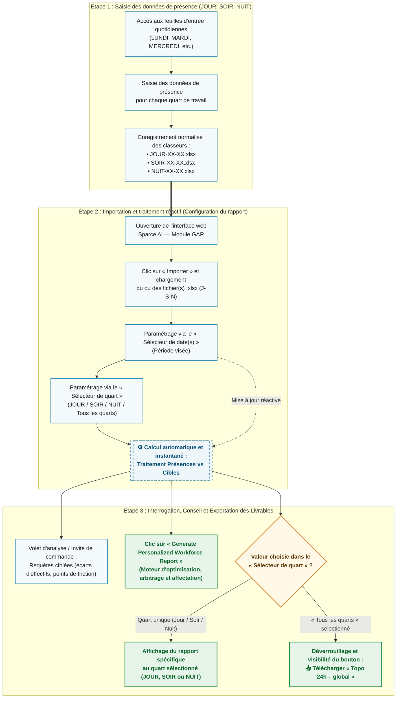

# 📊 Sparce AI — Module GAR (Gestion des activités de remplacement)

**Documentation Produit & Procédure Opérationnelle Standard (POS / SOP)**  
**Public cible :** Gestionnaires d'opérations, planificateurs d'horaires, analystes RH et Direction des Ressources Technologiques et Informationnelles (DRTI).

---

## 🎯 Objectif Opérationnel

**Sparce AI (Module GAR)** est une solution d'aide à la décision et d'optimisation des effectifs. Cette plateforme automatise la réconciliation entre les données de présence réelles et les cibles opérationnelles, détecte les écarts critiques par quart de travail et génère des livrables stratégiques d'arbitrage et d'affectation destinés aux Ressources Humaines.

---

## 🔄 Architecture du Flux Opérationnel (Logigramme)

Le diagramme ci-dessous illustre le cycle complet de traitement, de la saisie terrain jusqu'à la génération conditionnelle des rapports décisionnels :

---

## 📋 Procédure Opérationnelle Étape par Étape

### Étape 1 : Saisie des données de présence (JOUR, SOIR, NUIT)
1. **Accès aux feuilles quotidiennes :** Ouvrez le classeur de suivi et accédez aux onglets d'entrée journaliers (`LUNDI`, `MARDI`, `SAMEDI`, etc.).
2. **Saisie opérationnelle :** Renseignez les données de présence effectives pour le quart de travail correspondant.
3. **Nomenclature d'enregistrement :** Enregistrez systématiquement les classeurs selon la convention normalisée afin d'assurer l'ingestion multi-quarts :
   * `JOUR-XX-XX.xlsx`
   * `SOIR-XX-XX.xlsx`
   * `NUIT-XX-XX.xlsx`

---

### Étape 2 : Importation et traitement dans Sparce AI (Module GAR)
1. **Lancement :** Ouvrez l'application web **Sparce AI — Module GAR**.
2. **Ingestion des fichiers :** Cliquez sur le bouton **Importer** et sélectionnez simultanément ou individuellement vos classeurs `.xlsx` (Jour, Soir, Nuit).
3. **Configuration du rapport (Volet de navigation latéral) :**
   * **Sélecteur de date(s) :** Sélectionnez la période cible. Le moteur exécute immédiatement et automatiquement le rapprochement *Présences vs Cibles*.
   * **Sélecteur de quart :** Filtrez sur un quart précis (`JOUR`, `SOIR`, `NUIT`) ou sélectionnez **`Tous les quarts`** pour une consolidation sur 24 heures. Le recalcul matriciel s'opère instantanément à chaque changement de sélection.

---

### Étape 3 : Interrogation et génération du conseil décisionnel
1. **Analyse interactive :** Utilisez le volet d'analyse / invite de commande de Sparce AI pour interroger directement les données chargées (identification des déficits d'effectifs, détection des goulots d'étranglement et points de friction opérationnels).
2. **Optimisation et arbitrage RH :** Cliquez sur le bouton **`Generate Personalized Workforce Report`** pour exécuter le moteur d'optimisation et produire les recommandations structurées d'arbitrage et de réaffectation.
3. **Exportation du bilan consolidé (Conditionnel) :**
   * Lorsque le **Sélecteur de quart** est positionné sur **`Tous les quarts`**, l'interface active l'option d'exportation globale.
   * Cliquez sur **Télécharger le rapport « Topo 24h – global »** pour extraire la synthèse complète couvrant l'ensemble du cycle de 24 heures.

---

## 🏛️ Gouvernance & Valeur Ajoutée (DRTI / Gestion Opérationnelle)

| Dimension | Bénéfice Opérationnel |
| :--- | :--- |
| **Intégrité des données** | Ingestion directe des classeurs `.xlsx` originaux sans manipulation intermédiaire ni perte de formules. |
| **Réactivité temps réel** | Recalcul dynamique des écarts *Présences vs Cibles* dès l'ajustement du **Sélecteur de date(s)** ou du **Sélecteur de quart**. |
| **Affichage contextuel intelligent** | Le livrable **« Topo 24h – global »** est verrouillé tant que la vue consolidée **« Tous les quarts »** n'est pas active, éliminant tout risque d'exportation partielle ou biaisée. |
| **Standardisation RH** | Production homogène des recommandations d'affectation via le moteur **Generate Personalized Workforce Report**. |

---
*Web app designed and optimized by Tristan Mayrand*
